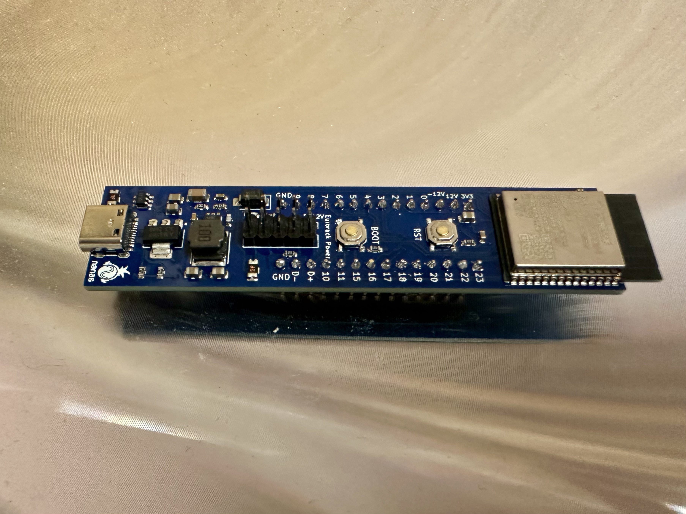
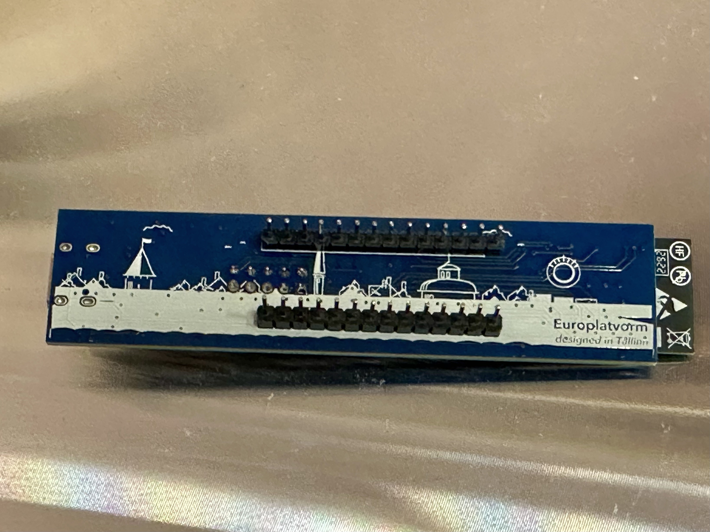
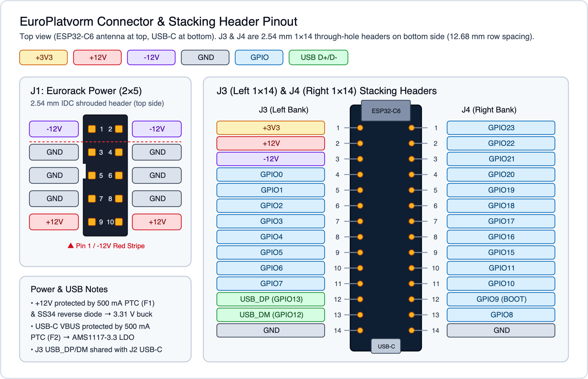

# EuroPlatvorm: ESP32-C6 Eurorack Motherboard

EuroPlatvorm brings an ESP32-C6 into a Eurorack case. It is a carrier board for stacking daughter boards: two 1x14 pin headers on the back pass GPIO pins and power rails straight through.

| Top | Bottom |
|-----|--------|
|  |  |

## Features

- ESP32-C6-WROOM-1-N4 module with native USB for flashing and serial
- USB-C port for programming and power
- Eurorack +12V power input through a 2x5 header
- Two 1x14 stacking headers (J3, J4) carrying 3V3, +12V, -12V, GND and 24 GPIO pins
- RST and BOOT push buttons
- Green power LED

## Board

| Spec | Value |
|------|-------|
| Size | 89.75 x 21.7 mm |
| Layers | 4 (top and bottom signal, inner 1 is a GND plane, inner 2 is a +3V3 plane) |
| Components | 34 (25 BOM lines) |
| CAD | KiCad 10, files in this folder |

Top of the board carries the power section, USB-C, buttons and the ESP32 module. The two carrier headers are through-hole parts on the bottom side, so daughter boards stack behind the board.

## Power

Both regulators feed the same +3V3 rail. The buck sets 3.31 V from the feedback divider (VFB 0.596 V, R1 100k, R2 22k). Reverse polarity on the eurorack ribbon is blocked by the SS34 diode; both inputs are fused with resettable 500 mA PTCs.

Running from eurorack power puts about 2.7 V back onto the USB VBUS line through the AMS1117 reverse path. The F2 PTC limits that current. Use one power source at a time to keep VBUS clean.

The -12V rail from the eurorack bus passes to J3 pin 3 for daughter boards. The onboard logic runs entirely on +3V3.

## Connectors

### J1: Eurorack power, 2x5

| Pin | Net | Pin | Net |
|-----|-----|-----|-----|
| 1 | -12V | 2 | -12V |
| 3 | GND | 4 | GND |
| 5 | GND | 6 | GND |
| 7 | GND | 8 | GND |
| 9 | +12V | 10 | +12V |

### J3: carrier header left, 1x14

| Pin | Net | Pin | Net |
|-----|-----|-----|-----|
| 1 | +3V3 | 8 | GPIO4 |
| 2 | +12V | 9 | GPIO5 |
| 3 | -12V | 10 | GPIO6 |
| 4 | GPIO0 | 11 | GPIO7 |
| 5 | GPIO1 | 12 | USB_DP |
| 6 | GPIO2 | 13 | USB_DM |
| 7 | GPIO3 | 14 | GND |

### J4: carrier header right, 1x14

| Pin | Net | Pin | Net |
|-----|-----|-----|-----|
| 1 | GPIO23 | 8 | GPIO16 |
| 2 | GPIO22 | 9 | GPIO15 |
| 3 | GPIO21 | 10 | GPIO11 |
| 4 | GPIO20 | 11 | GPIO10 |
| 5 | GPIO19 | 12 | GPIO9 |
| 6 | GPIO18 | 13 | GPIO8 |
| 7 | GPIO17 | 14 | GND |

USB_DP and USB_DM on J3 are the same nets as the USB-C data lines (ESP32-C6 GPIO12 / GPIO13). A daughter board can expose a second USB port on them, and doing so shares the port with J2.

### J2: USB-C

USB 2.0 receptacle used for flashing and power. CC1 and CC2 carry 5.1k pull-downs. Data lines pass through a USBLC6-2SC6 ESD protector to the ESP32-C6 native USB peripheral.

## Buttons and LED

| Ref | Function |
|-----|----------|
| SW1 (RST) | Pulls ESP32 EN low, resets the chip |
| SW2 (BOOT) | Pulls GPIO9 low, enters download mode for flashing |
| D2 | Green power indicator on +3V3, 1k series resistor |

## Files

| Path | Contents |
|------|----------|
| `EuroPlatvorm.kicad_sch`, `EuroPlatvorm.kicad_pcb` | Schematic and PCB source |
| `fabrication/` | JLCPCB-ready gerbers, drill files, `EuroPlatvorm-BOM.csv`, `EuroPlatvorm-CPL.csv` |
| `datasheets/` | PDFs for TPS54202, AMS1117, USBLC6-2SC6, ESP32-C6-WROOM-1, the power header, USB-C |
